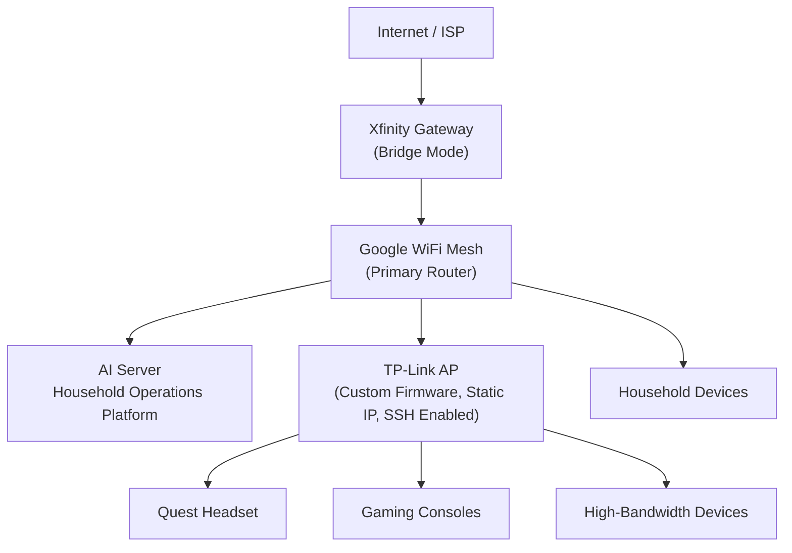

# AI Server Project Context

**Purpose:** Primary onboarding briefing for new contributors and AI sessions.
This is a high-level snapshot, not an operational runbook. The
[development roadmap](./roadmap/roadmap.md), focused subsystem guides, source,
and tests remain authoritative for detailed status and behavior.

**Status snapshot:** 2026-10-26. Distinguish implemented Windows behavior,
portable/mock test evidence, nested-lab validation, plans, and physical-host
acceptance. Success in one environment does not prove behavior in another.

## Project Overview

### Mission and goals

The AI Server (also called the **AI Command Interface**) is a local-first
household AI and operations platform under development. It combines a browser
dashboard, a Python/FastAPI backend, local model inference, system telemetry,
and an optional Discord bot. The intended deployment target is a dedicated
Linux server running Proxmox VE.

Goals include:

- Provide one interface for local AI chat, web research, model inventory and
  switching, host monitoring, and operations.
- Support private per-account conversations separately from the shared,
  admin-only AI Interface.
- Add bounded, evidence-based diagnostics and household infrastructure
  awareness over time.
- Prepare Linux/Proxmox deployment while developing shared application
  behavior and portability tests on Windows.

### Intended household operations use cases

Current implemented use cases include local AI chat and optional research,
system/GPU telemetry, private conversation history, explicitly published
admin-shared notes, observe-only diagnostics, backend logs, Discord bot
status/control, and read-only Proxmox VM/container inventory.

Future concepts include network-aware household diagnostics, infrastructure
inventory, a conversational voice interface, and possible separation of
user-facing and maintenance AI workloads. These concepts are not implemented
integrations; see [Future Capabilities](#future-capabilities).

### Core architectural principles

- Keep model inference and application data local where the selected
  deployment supports it.
- Keep identity and authorization in the backend; dashboard role-based
  visibility is not the security boundary.
- Separate private account conversations, the admin-shared operational
  transcript, explicitly published shared notes, and diagnostic history.
- Keep providers and operating-system-specific telemetry behind explicit
  contracts; report unavailable data rather than fabricating readings.
- Treat external research content as untrusted evidence.
- Use narrow, read-only infrastructure integrations first. Never infer
  permission to make changes from inventory or monitoring access.
- Validate shared behavior on Windows, then separately validate Linux,
  Proxmox, network exposure, hardware, and recovery on their target
  environments.

## Development Philosophy

- **Observe First:** Diagnostics and initial infrastructure monitoring are
  explicitly requested and read-only. No live repair, scheduled maintenance,
  network changes, or general-purpose command execution is implemented.
- **Verify Before Action:** Model output is not authority. Any future action
  must be checked by deterministic backend policy, authorization, preconditions,
  and independent verification.
- **Fail Closed:** Reject unknown identities, unauthorized requests, invalid
  configuration, ambiguous hardware selection, and invalid/missing telemetry.
  Distinguish unavailable or unconfigured from healthy or empty.
- **Rollback When Uncertain:** Deployment and future operational changes need a
  known recovery path. Existing nested-lab rollback evidence restores a saved
  snapshot of the current build, not a previous distinct application release.
- **Documentation-Driven Development:** Read the roadmap and affected
  subsystem guide before implementation; update affected documentation with
  the code. Keep implemented, partial, planned, and unverified states explicit.
- **Evidence-Based Validation:** Use focused tests and observed target behavior.
  Mocks and source-contract tests prove only their defined scope. Record
  Windows, nested-lab, and physical-host evidence separately.

## Current Architecture

### Frontend

The frontend is static HTML, CSS, and native browser JavaScript ES modules;
there is no bundler. [index.html](../index.html) loads [js/app.js](../js/app.js),
which owns authentication, navigation, chat/research, model selection, and bot
controls. Focused modules handle backend logs, diagnostics/VM inventory,
system telemetry, and UI preferences. It is served over HTTP/HTTPS to allow
module imports.

Playwright browser tests mock API responses. They cover module loading,
authentication gating and failures, role controls, navigation, and persisted
preferences. They are not backend authorization or deployment tests.

### Backend

`ai-backend/main.py` assembles the FastAPI app and preserves the `main:app`
server entry point. `ai-backend/api/` contains shared runtime setup,
authentication/logging/CORS middleware, and routers grouped into auth, chat,
memory, research, and operations. Related modules handle configuration,
SQLite memory, diagnostics, model lifecycle, system statistics, Proxmox
authentication/inventory, and SearXNG research. llama.cpp is a separate local
HTTP service. Backend settings are validated at startup; logs use console and
rotating-file handlers, and chat message text is not logged.

### Authentication

The dashboard supports local accounts and Proxmox identities explicitly
mapped to dashboard roles. The application owns sessions and permissions.
Sessions use protected cookies; state-changing browser requests require CSRF
and origin checks. Roles are `viewer`, `operator`, and `admin`. Account and
Proxmox role administration is performed through a trusted local CLI.
The optional Discord bot uses a separate machine credential and does not use
dashboard sessions.

### Diagnostics

`ai-backend/diagnostics.py` performs explicitly requested, bounded health and
resource observations. The implemented checks include backend/service status,
resource thresholds, and read-only SQLite integrity. There is no scheduled
collection, model-driven diagnosis, or live remediation.

### Incident tracking

Observations, incident state/transitions, and audit evidence are persisted in
the configured local SQLite database with bounded retention. Open incidents
and pending threshold evidence restore on backend startup. JSON evidence
reports refer to saved observations; generating a report does not run probes.

### Memory systems

The SQLite memory store contains separate data domains:

- Private per-account AI Chat conversations, with ownership checks and bounded
  recent-turn context.
- Admin-published shared operational notes, included only in authorized
  dashboard chat/research context.
- The admin-shared AI Interface operational transcript, separate from private
  AI Chat history.
- Bounded diagnostics observations, incidents, and audit history.

Reviewed diagnostic runbooks are bundled and searched with deterministic local
lexical search. This is not semantic/vector retrieval. Conversation contents
are not automatically extracted into facts or used for model training.

### Maintenance Subsystem

The design describes a future AI Maintenance Agent, but the live implementation
is observe-only. Maintenance/remediation paths currently exist as deterministic
in-memory simulations with fixed fixtures; they do not connect to host
services, shell, Proxmox, or persistent application state. Scheduling, model
driven diagnosis, approvals/execution, and live remediation are not
implemented.

### Infrastructure Integrations

- **System telemetry:** CPU/RAM telemetry is available through `psutil`.
  Windows reports live GPU engine load and dedicated VRAM from Windows
  counters. Linux AMD telemetry reads kernel `amdgpu` sysfs counters through a
  platform provider and has fixture tests; live Linux/physical-GPU readings
  are unverified and do not establish ROCm/HIP inference support.
- **Proxmox:** a backend-only read-only API token can retrieve VM/container
  inventory. A nested-lab live inventory request returned the expected fields.
  No VM mutation or guest-console controls are implemented.
- **Network services:** DHCP/DNS/web/routing views are planning UI. There is no
  network telemetry provider or network-changing integration.
- **External services:** llama.cpp is used for local inference. SearXNG is an
  optional research service and must be installed/configured to search. The
  Discord bot is optional.
- **Deployment:** rootless Podman/Quadlet definitions exist for backend and
  dashboard containers. A signed `.tar.gz` application update flow and
  separate updater are design-only.

## Environment Strategy

### Windows Test Environment

Windows 11 with Python 3.12 is the active shared-application development and
prototype environment. The RX 6800 XT is currently available in this machine.
Windows tests cover application behavior, local llama.cpp/Vulkan inference,
GPU counters, DirectML smoke tests, and browser regressions. Keep the Python
environment and model/build files outside the OneDrive repository under
`%LOCALAPPDATA%\AI-Server`.

**Purpose:** Build shared application features and run deterministic tests
before moving them to Linux. Windows results do not validate Linux services,
ROCm, Proxmox networking, or physical-host recovery.

### Nested Lab Environment

Proxmox VE 9.1-1 runs as a nested Hyper-V guest on the Windows PC. The
dashboard and backend are deployed in rootless Podman/Quadlet containers with
ports bound to guest loopback. The containers are active and healthy but not
configured for boot auto-start. A live in-container Proxmox inventory read,
stop/start, controlled backend restart, start-limit behavior, and recovery
from an unavailable candidate were recorded in the roadmap/testing guide.
That rollback restored the saved current build, not a different release.
Boot/reboot recovery, NGINX/TLS, and LAN application exposure remain
unverified.

**Purpose:** Prepare Linux/Proxmox deployment and integration work. Results
are nested-lab evidence only, not physical server acceptance.

### Planned Physical AI Server

The target is a dedicated Proxmox VE 9.x server using direct host GPU access
(GPU passthrough is not planned). The current intended initial GPU is one
RX 6800 XT, moved from the Windows PC after a replacement GPU is obtained.
Potential Linux components include ROCm/HIP, ROCm-built llama.cpp,
Podman/Quadlet, NGINX, and other runtimes/services described in the
[deployment runbook](./deployment/linux-proxmox-transition.md). The RX 6800 XT
and Proxmox combination is not listed as officially supported by AMD in the
documented compatibility review; treat GPU compute as experimental until
verified against the exact host.

**Purpose:** Final target-host validation of hardware, kernel/runtime
compatibility, permissions, network exposure, service lifecycle, performance,
and recovery. Phase 5 is waiting for this physical server.

## Current Infrastructure

The following topology was supplied as a planning reference and has not been
independently verified on the AI Server. Cabling, addressing, mesh backhaul,
DHCP/DNS ownership, VLANs, and firewall policy are not documented.

### Reported components

- **Xfinity Gateway:** reported bridge mode, providing ISP connectivity; not
  intended for direct platform management.
- **Google WiFi Mesh:** reported primary router and mesh platform, managed
  through Google Home. Considered limited-visibility; no direct integration
  is selected.
- **TP-Link AP:** reported access-point mode, custom firmware, static
  management IP, and SSH enabled. It is a potential read-only telemetry
  source, not an implemented integration.
- **Household devices:** include the reported Quest headset, consoles, and
  high-bandwidth/low-latency devices behind the TP-Link AP, plus other devices
  on the Google WiFi network.

### Current telemetry and limitations

Current telemetry is for the AI Server host: CPU/RAM, plus Windows RX 6800 XT
load and dedicated VRAM. A Linux `amdgpu` sysfs provider exists and is covered
by fixture tests, but live Linux readings have not been validated. There is
currently no telemetry from the Xfinity gateway, Google WiFi, TP-Link AP, or
household clients; no WAN/LAN/Wi-Fi correlation; and no network incident
diagnosis. TP-Link SSH availability as reported does not imply application
authorization or define a safe integration. Network-aware diagnostics remain
observe-only in the initial phase and are not implemented.

See the [household topology reference](./operations/home-network-topology.md)
for component notes and proposed future integration points.

## Server Hardware Plans

### Current development hardware

The documented Windows development machine is Windows 11 and currently has
the AMD RX 6800 XT available for local Vulkan/llama.cpp tests and Windows GPU
telemetry. The repository does not establish its motherboard or CPU model.

### Planned server platform and GPU

The planned platform is a **Z590 motherboard + Intel Core i9-11900KF**, with
an RX 6800 XT as the initial GPU. The RX 6800 XT is intended to be dedicated
strictly to maintenance AI, where its 16 GB VRAM is more important than
inference speed. The exact motherboard model and delivered physical hardware
still need confirmation; this is a plan, not verified inventory.

The RX 6800 XT has 16 GB VRAM according to the deployment planning guide. The
host is planned for 32 GB system RAM initially, with a possible 64 GB upgrade;
storage plans include a 2 TB initial NVMe and HDD-backed bulk/lower-I/O
workloads. These are provisional plans, not a finalized bill of materials.
The storage layout, redundancy, backup strategy, exact motherboard model, and
physical inventory must be confirmed.

### Planned AI workload roles and possible second GPU

The intended role for the RX 6800 XT is **Maintenance AI GPU**: diagnostics,
incident analysis, runbook workflows, system-health and network diagnostics,
and scheduled maintenance. It is not intended for household-facing AI.

If a second GPU is added, it would be dedicated to **User AI**: household chat,
research, Discord integrations, vision, and conversational interaction. The
possible second-GPU candidates are the **Radeon RX 7900 XT/XTX** or **Radeon
RX 9070 XT**. The 7900 XT/XTX is favored if additional VRAM capacity is the
main requirement; the 9070 XT is a candidate for its newer RDNA 4 architecture
and potential speed/efficiency advantages. The exact 7900 model and
comparative workload performance are not established.

The second card is not selected or acquired. Until a second GPU and runtime
arrangement are validated, the existing single-GPU, single-llama.cpp model
handoff remains the interim design; the intended dedicated roles do not
establish that both AIs can operate concurrently. Power/cooling, compatibility,
isolation, and performance remain unvalidated. See the
[GPU plan](./gpu/gpu-plan.md#potential-future-multi-gpu-inference) and
[household infrastructure reference](./operations/home-network-topology.md#possible-multi-gpu-role-separation).

## Completed Milestones

Summary of milestones documented in the roadmap (not a substitute for its
scope notes and evidence boundaries):

- **Phase 1 — Local Test Environment: Done.** Dashboard and backend
  foundations, chat/model discovery, system monitoring, optional Discord bot,
  and operational logging.
- **Phase 2 — Portable Backend and Reliability: substantially implemented
  locally.** Configuration/logging, local chat streaming, web research,
  dashboard authentication, account-scoped conversation history,
  admin-shared notes and transcript, bounded observe-only diagnostics,
  incident history, and backend logs. Linux/proxy/physical behavior remains
  separately gated.
- **Phase 3 — Mocked Integrations and Portable Feature Work: partial.**
  Read-only Proxmox inventory and contracts, reviewed local lexical runbooks,
  deterministic maintenance/remediation simulations, browser modules, and
  other portable feature groundwork. Live remediation and infrastructure
  mutation are not included.
- **Frontend browser regressions:** six Playwright tests cover native module
  loading, authentication gating and failure, admin/operator/viewer controls,
  panel navigation, and saved preferences. The test-discovered CSS
  `hidden`-attribute issue was fixed.
- **Linux telemetry provider:** Linux AMD `amdgpu` sysfs provider and
  deterministic fixtures are implemented; live Linux/physical readings and
  ROCm/HIP inference are not validated.
- **Nested-lab deployment evidence:** rootless backend/dashboard containers
  are healthy and loopback-bound; some service restart, limit, and
  current-build snapshot recovery checks passed. Auto-start, reboot recovery,
  and rollback between distinct application releases remain outstanding.

## Current Priorities

According to the roadmap's integration-priority order:

1. **Linux deployment and service lifecycle:** highest-priority work; partial.
   Portable Containerfile/Quadlet contracts pass and some nested-lab checks
   passed. The next lab checks include deployment-script `--check` and
   `--report` behavior and service recovery after guest reboot. The user plans
   further nested-VM work separately; do not infer that it has already been
   performed.
2. **Proxmox identity and authorization:** test live Proxmox ticket login,
   explicit identity-to-role mapping, cookies, CSRF/origin checks, and role
   boundaries in the nested lab with least-privilege access.
3. **Linux application smoke coverage:** verify backend startup, SQLite paths
   and permissions, logging, authentication, diagnostics, and API health as
   the service account; add optional services only when installed.
4. **Deployment workflow:** after the preceding lab checks, explore a separate
   app-deployment installer with read-only preflight, explicit confirmation,
   protected configuration, pinned versions, health checks, and rollback.
   The signed `.tar.gz` updater is design-only.
5. **Physical-host integration:** blocked until the planned physical Proxmox
   server is available. ROCm/HIP, production networking/proxy, GPU readings,
   reboot/recovery, and target acceptance cannot be established on Windows.
6. **Lower-priority product contracts:** define model-agnostic image-job
   contracts and a workspace-restricted website agent only after permissions,
   workspace boundaries, and recovery are decided. Keep file/command
   integrations disabled until then; a Windows-only image runtime is not a
   priority.

Concepts in the candidate backlog—including network-aware diagnostics, the
conversational household interface, managed Wi-Fi integration, and multi-GPU
workload separation—are not the current implementation priority.

## Future Capabilities

These are plans or concepts, not implemented behavior:

- **Network-Aware Diagnostics:** observe-only correlation of WAN, LAN, Wi-Fi,
  service, and client evidence; distinguish possible ISP/router/AP/congestion/
  client issues; produce evidence-based reports and history before considering
  separately gated remediation.
- **Conversational Household Interface:** a future household-facing natural
  interaction layer for diagnostics, maintenance, and services. A symptom
  request is planned to temporarily gate household inference, hand the single
  llama.cpp runtime to the approved maintenance model, then restore the
  previous household model after checks. This is not implemented; identity
  and authorization must be designed and must not be inferred from voice.
- **Voice STT/TTS:** local speech-to-text input and text-to-speech responses
  are candidate components; models, devices, consent, and audio retention are
  undecided.
- **Managed WiFi Integration:** UniFi and TP-Link Omada are evaluation
  candidates, not selected products. Desired capabilities include device
  inventory, client statistics, events, and supported least-privilege
  telemetry.
- **Multi-GPU AI Operations:** evaluate separate user-AI and maintenance-AI
  GPU roles only after the host hardware and a measured single-GPU baseline
  are established.
- **Infrastructure Awareness:** add verified read-only inventory and health
  sources for network and household services, starting with explicit scope
  and no configuration changes.

See the [roadmap candidate backlog](./roadmap/roadmap.md#candidate-backlog--not-scheduled)
and [household infrastructure reference](./operations/home-network-topology.md).

## Repository Guide

### Major directories and files

- `ai-backend/` — FastAPI app assembly, auth, configuration, memory,
  diagnostics, telemetry, model management, Proxmox clients/contracts,
  research, maintenance simulations, and backend unit tests.
- `ai-backend/api/` — Shared runtime/middleware and responsibility-focused
  FastAPI route modules.
- `ai-backend/gpu/` — platform telemetry providers, llama.cpp client, GPU
  placeholders, and DirectML smoke test.
- `ai-backend/tests/` — Python `unittest` suites for auth, API behavior,
  diagnostics, memory, telemetry, Proxmox, configuration, and deployment
  contracts.
- `ai-discord-bot/` — optional Discord client, backend API wrapper, and
  configuration.
- `css/`, `js/`, `index.html` — static dashboard source and native browser
  modules.
- `tests/frontend/` — Playwright browser regression config, static
  allowlisted test server, and UI tests.
- `deploy/quadlet/`, `Containerfile` — rootless backend/dashboard deployment
  definitions and shared image build.
- `scripts/proxmox/` — conservative Proxmox host-preparation preflight and
  optional base-tools installer.
- `scripts/searxng/` — optional SearXNG installation/run support.
- `docs/` — topic-organized architecture, backend, security, operations,
  deployment, diagnostics, GPU, frontend, and roadmap guides.
- Root `.bat` launch/setup files — Windows test environment launchers;
  separate LAN launchers are opt-in HTTPS tests.

### Testing structure

- Python tests use `unittest` under `ai-backend/tests/`.
- Frontend browser tests use Playwright/Chromium under `tests/frontend/` and
  run with `npm run test:frontend`.
- Linux provider fixtures and Containerfile/Quadlet contract tests run on
  Windows but do not execute Linux hardware, Podman, systemd, or reboot
  recovery.
- Follow [testing-environment.md](./operations/testing-environment.md) for
  exact commands and claims supported by each suite.

### Documentation areas

Start at [docs/README.md](./README.md) for the documentation index.
Important guides include the [roadmap](./roadmap/roadmap.md),
[architecture](./architecture/architecture.md),
[API](./backend/api.md), [authentication](./security/authentication.md),
[diagnostics design](./diagnostics/ai-diagnostics-self-healing.md),
[deployment runbook](./deployment/linux-proxmox-transition.md),
[GPU plan](./gpu/gpu-plan.md), and
[household network topology](./operations/home-network-topology.md).

## AI Session Handoff

- **Project:** local-first AI Command Interface for household AI and
  operations, developed on Windows and intended for a Linux/Proxmox server.
- **Validated:** Windows application/backend behavior and tests; local
  llama.cpp/Vulkan smoke path and Windows GPU telemetry; DirectML synthetic
  test; six browser regressions; portable Python tests; selected loopback
  container lifecycle and read-only inventory checks in the nested Proxmox
  lab.
- **Not validated:** physical-server deployment; Linux live GPU telemetry;
  RX 6800 XT ROCm/HIP inference on Proxmox; production HTTPS/proxy/LAN access;
  boot/reboot recovery; rollback between distinct application releases;
  network telemetry; live maintenance/remediation; voice; or multi-GPU
  operation.
- **Direction:** preserve native browser modules and portable backend
  behavior; continue the roadmap's Linux deployment/service lifecycle and
  nested-lab checks before broad product integrations. Physical-host work
  remains gated on the server.
- **Constraints:** diagnostics and first network integrations remain
  observe-only; backend authorization is authoritative; use least privilege;
  do not turn model output into action authority; do not claim a mock or
  nested-lab result as physical-host acceptance; preserve recovery access and
  persistent data.
- **Hardware plan:** the current plan is a Z590 motherboard with an Intel
  Core i9-11900KF and RX 6800 XT. Confirm the exact motherboard model and
  delivered hardware before host-specific deployment.

For current status, read the [roadmap](./roadmap/roadmap.md) and the focused
guide for the requested subsystem before editing code.
